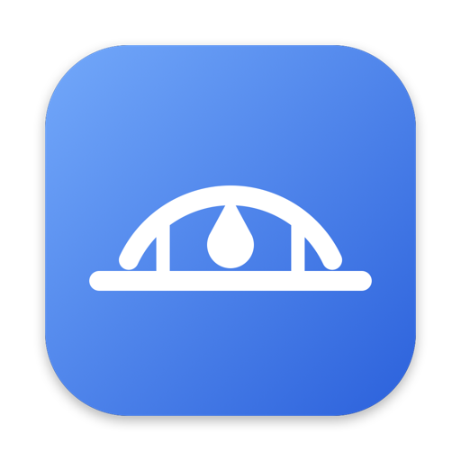

<p align="center"></p>

# DropBridge

**AirDrop ↔ Quick Share for Mac and Android.** Your phone shows up in Finder's AirDrop, and your Mac shows up in Android's Quick Share. There's no app on the phone and nothing to pair.

[](https://github.com/Aayushkalikote/DropBridge/releases)
[](LICENSE)


https://github.com/user-attachments/assets/9e5c04db-2abf-4916-bfa1-65eecae10b17

## Why DropBridge?

Files go straight from the Mac to the phone over your Wi-Fi. Nothing uploads to a cloud and there's no size cap, so large videos move at your Wi-Fi's speed. You use the AirDrop and Quick Share screens you already know.

| | DropBridge | Google's AirDrop support | NearDrop | LocalSend | KDE Connect | Send Anywhere |
| --- | :---: | :---: | :---: | :---: | :---: | :---: |
| Nothing to install on the phone | ✅ | ✅ | ✅ | ❌ | ❌ | ❌ |
| Phone shows up in Finder's AirDrop | ✅ | ✅ | ❌ | ❌ | ❌ | ❌ |
| Mac shows up in Android's Quick Share | ✅ | ✅ | ✅ | ❌ | ❌ | ❌ |
| Works with any Android phone | ✅ | 🟡 | ✅ | ✅ | ✅ | ✅ |
| Files stay on your network | ✅ | ✅ | ✅ | ✅ | ✅ | 🟡 |
| Free | ✅ | ✅ | ✅ | ✅ | ✅ | 🟡 |
| Open source | ✅ | ❌ | ✅ | ✅ | ✅ | ❌ |

🟡 Google's AirDrop support works only on some Pixel and Galaxy models. Send Anywhere relays files through its servers when a direct connection fails, and its free tier has ads and limits. NearDrop sends from the Finder **Share** menu, not the AirDrop window. Comparison as of October 2026.

## Install

```sh
brew install aayushkalikote/tap/dropbridge
brew services start dropbridge
```

If macOS asks about **local network** access, click **Allow**.

> [!IMPORTANT]
> Install DropBridge with Homebrew only. The files on the [Releases](https://github.com/Aayushkalikote/DropBridge/releases) page are for Homebrew to download. macOS blocks the `dropbridge` binary if you download it in a browser, because Apple has not signed it yet. If you already downloaded it, unblock it with `xattr -d com.apple.quarantine dropbridge`.

## Set up the phone (once)

1. Use the **same Wi-Fi** as the Mac.
2. In **Quick Share**, set *Who can share with you* to **Everyone**.

## Use

| From → To | How |
| --- | --- |
| **Mac → Android** | Finder → **AirDrop** → drop files on the phone → accept on the phone |
| **Android → Mac** | Share → **Quick Share** → pick the Mac → **Accept** on the Mac (files go to `~/Downloads`) |

Keep the phone **unlocked**: Android hides Quick Share while the screen is off.

## Update

DropBridge shows a macOS notification when a new release is out. To update:

```sh
brew update
brew upgrade dropbridge
brew services restart dropbridge
```

`brew upgrade` lists what changed in the new version.

## Uninstall

```sh
brew services stop dropbridge
brew uninstall dropbridge
rm -rf ~/Library/Application\ Support/dropbridge ~/Library/Caches/dropbridge  # optional: certificate and remembered phone names
```

---

<details>
<summary><b>🩺 Phone not showing up?</b></summary>

Run:

```sh
dropbridge doctor
```

It checks Wi-Fi, AirDrop and the background service, and lists the phones it can see. Common fixes:

- **The phone is asleep.** Unlock it, and it reappears within seconds.
- **Different networks.** Guest Wi-Fi and networks with "client isolation" block it.
- **Local network blocked.** Allow `dropbridge` in System Settings → Privacy & Security → Local Network.
- **Shows as "Android phone 165" (or another number).** Some phones hide their name, so DropBridge adds the last number of the phone's IP instead. Send one file from the phone to the Mac, or scan the QR code below, and DropBridge remembers the name.
- **Still missing.** Run `dropbridge qr <file>...` and scan the code with the phone's camera app. The files go to the phone as soon as it has scanned the code. Plain `dropbridge qr` only makes the phone show up in AirDrop, with its real name, for a couple of minutes; the phone shows "Connecting" until you drop a file on it.

</details>

<details>
<summary><b>⚙️ Options</b></summary>

```
dropbridge [--auto-accept] [--download-dir <path>] [--test-peer]
dropbridge doctor
dropbridge qr [<file>...]
```

| Option | Effect |
| --- | --- |
| `--auto-accept` | Accept incoming files without asking. Anyone on your Wi-Fi could then send you files. |
| `--download-dir <path>` | Where incoming files go (default `~/Downloads`). |
| `--test-peer` | Adds a "dropbridge test" device to AirDrop. It checks the Mac side without a phone. |
| `qr [<file>...]` | Prints a QR code. The files go to the phone that scans it. Without files, the phone shows up in AirDrop. |

To use an option, run `brew services stop dropbridge` and start `dropbridge` with the option yourself.

</details>

<details>
<summary><b>⚠️ Limits</b></summary>

- **Same Wi-Fi only.** macOS doesn't let apps use Quick Share's Bluetooth or Wi-Fi Direct modes.
- **Mac ↔ Android only.** iOS doesn't let apps add devices to an iPhone's AirDrop list.
- **Folders arrive as separate files.** Quick Share has no folders.
- **Unofficial.** Neither Apple nor Google supports it, so an OS update can break it.

</details>

<details>
<summary><b>🔧 How it works</b></summary>

For each Quick Share device on your network, DropBridge advertises a matching AirDrop receiver on the Mac's AWDL interface. macOS lists it in Finder like any nearby device. When you drop a file, Finder uploads it to DropBridge over HTTPS. DropBridge unpacks the upload and sends it to the phone over Quick Share. It answers Finder only after the phone has accepted or declined. The Quick Share side uses [rqs_lib](https://github.com/Martichou/rquickshare).

</details>

<details>
<summary><b>🛠️ Development</b></summary>

Want to contribute? Read [CONTRIBUTING.md](CONTRIBUTING.md).

```sh
cargo test
cargo run --release -- --test-peer        # Mac side without a phone
RUST_LOG=dropbridge=debug cargo run --release
```

**Releasing:** add a changelog section below, set `version` in `Cargo.toml`, then push a tag such as `v0.2.0` or `v0.2.0-alpha.1`. Tags with a `-` suffix become pre-releases. Start every changelog entry with `Breaking:`, `Feature:`, `Enhancement:`, `Fix:`, `Security:` or `Docs:`. The release notes list entries in that order, and an untyped entry stops the release.

</details>

## Changelog

<details>
<summary><b>v0.1.2</b> — unreleased</summary>

### v0.1.2

- Enhancement: New releases reach `brew upgrade` right away. The release workflow now updates the Homebrew formula itself.

</details>

<details>
<summary><b>v0.1.1</b> — 2026-10-28 </summary>

### v0.1.1

- Fix: Two Macs running DropBridge near the same phone no longer share one AirDrop entry. Each Mac now shows its own entry for the phone.
- Security: DropBridge only accepts AirDrop from the Mac it runs on. Before, nearby Macs saw its phones in their AirDrop list too, and files sent that way passed through this Mac.
- Fix: Names of Macs that send over Quick Share are no longer remembered, so a phone that later gets the same IP no longer shows a Mac's name.
- Feature: DropBridge checks GitHub once a day for a newer release and shows a macOS notification, once per version. `dropbridge doctor` shows it too.
- Feature: `dropbridge qr <file>...` prints a Quick Share QR code and sends the files to the phone that scans it, even when the phone hides its name or is not found on its own. Without files, the phone shows up in AirDrop under its real name.
- Enhancement: A phone whose name is not known yet shows as "Android phone" plus the last number of its IP (for example "Android phone 165"), so several such phones can be told apart.
- Enhancement: `brew install` and `brew upgrade` list what changed in the new version.

</details>

<details>
<summary><b>v0.1.0</b> — 2026-10-16</summary>

### v0.1.0

- Feature: Android phones on the same Wi-Fi show up in Finder's AirDrop window. Dropped files go to the phone over Quick Share.
- Feature: The Mac shows up in Android's Quick Share sheet. Incoming files ask Accept/Decline with a PIN and land in `~/Downloads`.
- Feature: `dropbridge doctor` checks Wi-Fi, AirDrop and the background service, and lists the phones in reach.
- Feature: Homebrew formula with a `brew services` background service.
- Enhancement: Phones that keep their Quick Share name hidden still work. DropBridge learns a phone's name from its first share and remembers it.

</details>

## License

GPL-3.0-only. AirDrop is a trademark of Apple Inc. Quick Share is a trademark of Google LLC and Samsung Electronics. DropBridge isn't affiliated with any of them.
